# Arepa Express · API Gateway y eventos con RabbitMQ en Azure

**Ejercicio de API Gateway y manejo de eventos** · DOSW 1 · Semana 14
**Autor:** Julian Felipe Morales Zambrano · Escuela Colombiana de Ingeniería Julio Garavito

Backend de una arepería con cuatro microservicios Spring Boot (Java 21, Maven, Spring Boot 3.5). Un **API Gateway** (Azure API Management) es la única puerta de entrada, y un **broker de mensajería** (RabbitMQ) permite que, cuando entra un pedido, la cocina y las notificaciones se enteren sin que nadie se quede esperando.

## Arquitectura

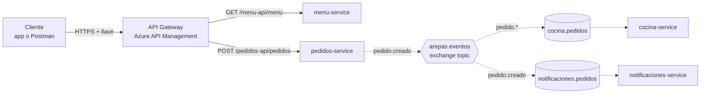

- **Flechas sólidas:** llamadas HTTP síncronas que pasan por el gateway.
- **Flechas punteadas:** eventos asíncronos que viajan por RabbitMQ.

| Servicio | Rol | Expuesto |
|---|---|---|
| `menu-service` | Devuelve el menú (`GET /menu`) | Externo (vía gateway) |
| `pedidos-service` | Recibe pedidos (`POST /pedidos`) y publica el evento `pedido.creado` | Externo (vía gateway) |
| `cocina-service` | Consume `cocina.pedidos` (binding `pedido.*`) y simula la preparación (3 s) | Interno |
| `notificaciones-service` | Consume `notificaciones.pedidos` (binding `pedido.creado`) y avisa al cliente | Interno |

Todo corre en Azure: los servicios en **Azure Container Apps**, el gateway en **Azure API Management** (plan Consumption) y RabbitMQ (`rabbitmq:3-management`) en **Azure Container Instances**.

---

## 1. Implementación del API Gateway

El cliente solo conoce **una URL**: `https://arepas-gw-<alias>.azure-api.net`. El gateway enruta, protege con una llave de suscripción y transforma las respuestas, sin tocar el código de los servicios.

### APIs publicadas

| API | Prefijo | Servicio detrás | Operación permitida |
|---|---|---|---|
| Menu API | `menu-api` | `menu-service` | `GET /menu` |
| Pedidos API | `pedidos-api` | `pedidos-service` | `POST /pedidos` |

Lo que no está registrado, el gateway no lo deja pasar. Ambas APIs exigen suscripción (`--subscription-required true`).

```bash
az apim create --name arepas-gw-$NOMBRE --resource-group $RG --location $LOC \
  --publisher-name "Arepa Express" --publisher-email <correo> --sku-name Consumption

az apim api create --resource-group $RG --service-name arepas-gw-$NOMBRE \
  --api-id menu-api --path menu-api --display-name "Menu API" \
  --service-url $MENU_URL --protocols https --subscription-required true
az apim api operation create --resource-group $RG --service-name arepas-gw-$NOMBRE \
  --api-id menu-api --url-template "/menu" --method GET --display-name "Ver menú"

# igual para pedidos-api con --url-template "/pedidos" --method POST
```

### Sin llave no entras (401)

Sin la llave `Ocp-Apim-Subscription-Key`, el gateway responde **401** y la petición **nunca llega al servicio**.

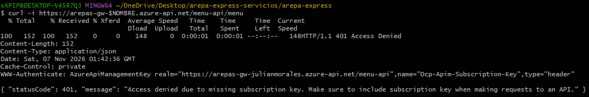

### Con llave (200)

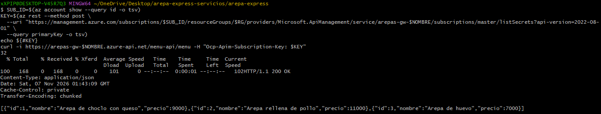

### Política del gateway

Las políticas son reglas que el gateway aplica a cada llamada. Se agregó una política de salida a *Menu API* (All operations) que firma cada respuesta con un header propio:

```xml
<outbound>
    <base />
    <set-header name="X-Arepa-Gateway" exists-action="override">
        <value>DOSW Company</value>
    </set-header>
</outbound>
```

El servicio no cambió; el gateway sí. En la respuesta aparece `X-Arepa-Gateway: DOSW Company`:

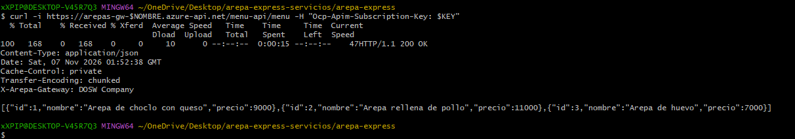

---

## 2. Uso de eventos con RabbitMQ

Cuando entra un pedido, `pedidos-service` **no llama** a cocina ni a notificaciones: publica un evento en el broker y responde de inmediato. Cada interesado lo recibe en su propia cola, a su ritmo.

### Conceptos usados

| Concepto | En este proyecto |
|---|---|
| **Exchange** | `arepas.eventos`, de tipo **topic**, durable |
| **Routing key** | `pedido.creado` (la etiqueta del mensaje) |
| **Cola** | `cocina.pedidos`, `notificaciones.pedidos` (durables) |
| **Binding** | `pedido.*` hacia cocina; `pedido.creado` hacia notificaciones |

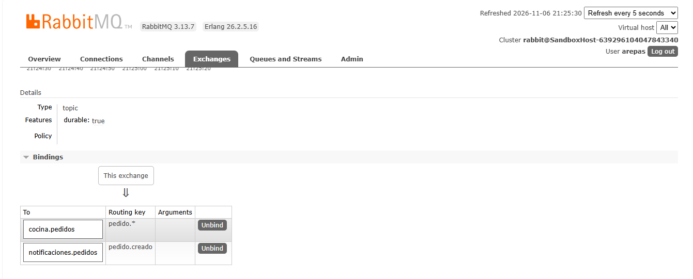

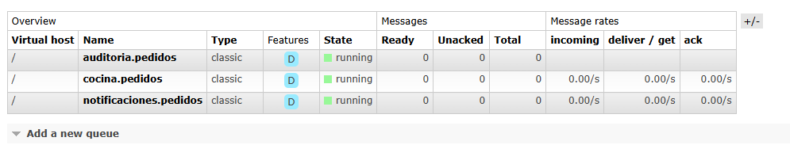

### Publicación: pedidos-service (arquitectura hexagonal)

Publicar un evento es un **puerto de salida** del dominio; RabbitMQ es solo el adaptador que lo implementa, así el caso de uso no conoce el broker.

```
pedidos-service/src/main/java/edu/eci/dosw/pedidos/
├─ domain/
│  ├─ model/       CrearPedidoRequest, PedidoCreadoEvent
│  └─ port/
│     ├─ in/       CrearPedidoUseCase        «interface»
│     └─ out/      PedidoEventPublisher      «interface»
├─ application/usecase/        CrearPedidoUseCaseImpl
└─ infrastructure/
   ├─ adapter/in/rest/         PedidoController
   ├─ adapter/out/messaging/   RabbitPedidoEventPublisherImpl
   └─ config/                  RabbitConfig (TopicExchange + convertidor JSON)
```

```java
// CrearPedidoUseCaseImpl
String id = UUID.randomUUID().toString().substring(0, 8);
publisher.publicarPedidoCreado(new PedidoCreadoEvent(
        id, pedido.cliente(), pedido.arepas(), LocalDateTime.now().toString()));
return id;

// RabbitPedidoEventPublisherImpl
rabbit.convertAndSend(RabbitConfig.EXCHANGE, "pedido.creado", evento);
```

### Consumo: cocina-service y notificaciones-service

Cada servicio declara **su propia cola** unida al mismo exchange. Así un mismo evento llega a los dos (comunicación de uno a muchos).

```java
// cocina-service
@RabbitListener(queues = "cocina.pedidos")
public void preparar(PedidoCreadoEvent pedido) throws InterruptedException {
    log.info("🔥 Preparando {} para {} (pedido {})", pedido.arepas(), pedido.cliente(), pedido.pedidoId());
    Thread.sleep(3000);   // la arepa se demora en la plancha
    log.info("✅ Pedido {} listo", pedido.pedidoId());
}

// notificaciones-service
@RabbitListener(queues = "notificaciones.pedidos")
public void avisar(PedidoCreadoEvent pedido) {
    log.info("📲 Hola {}, recibimos tu pedido {}. ¡Ya lo estamos preparando!", pedido.cliente(), pedido.pedidoId());
}
```

### Prueba de punta a punta (a través del gateway)

```bash
curl -X POST https://arepas-gw-$NOMBRE.azure-api.net/pedidos-api/pedidos \
  -H "Ocp-Apim-Subscription-Key: $KEY" -H "Content-Type: application/json" \
  -d '{"cliente":"Laura","arepas":["choclo","huevo"]}'
```

La respuesta llega de inmediato con `201` y estado `RECIBIDO`:

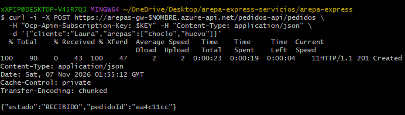

Segundos después, **el mismo pedido** aparece en los logs de cocina (preparando y listo 3 s después) y de notificaciones:

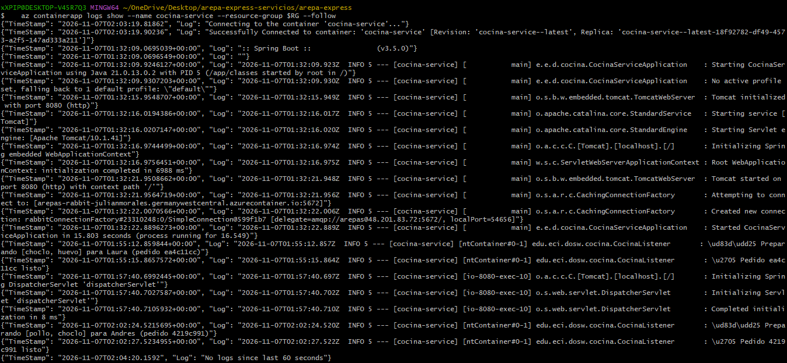

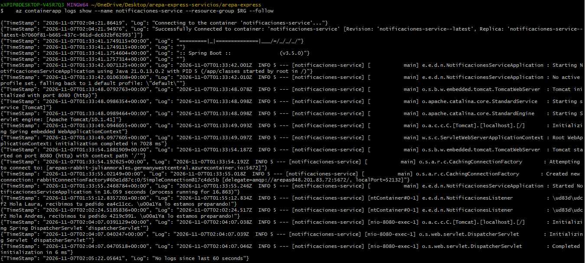

---

## 3. Experimentos

### Experimento 1 · Uno a muchos

Un solo pedido llegó a cocina y a notificaciones porque cada uno tiene su cola unida al mismo exchange (ver capturas de arriba). Si los dos leyeran de la **misma** cola, dejaría de ser uno a muchos y pasaría a ser competencia entre consumidores: cada mensaje lo procesaría solo uno de los dos y cada servicio vería únicamente una parte de los pedidos.

### Experimento 2 · Cola de trabajo

Se subió `cocina-service` a 2 réplicas y se enviaron 6 pedidos seguidos. La cola `cocina.pedidos` pasó a mostrar **2 consumers**:

```bash
az containerapp update --name cocina-service --resource-group $RG --min-replicas 2 --max-replicas 2
```

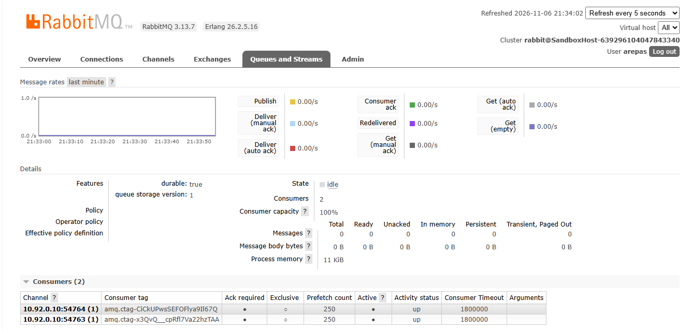

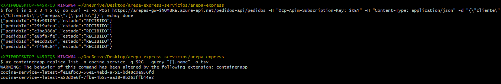

Cada pedido lo preparó **una sola réplica**, y el trabajo se repartió en partes iguales: una réplica atendió a Cliente1, 3 y 5, y la otra a Cliente2, 4 y 6.

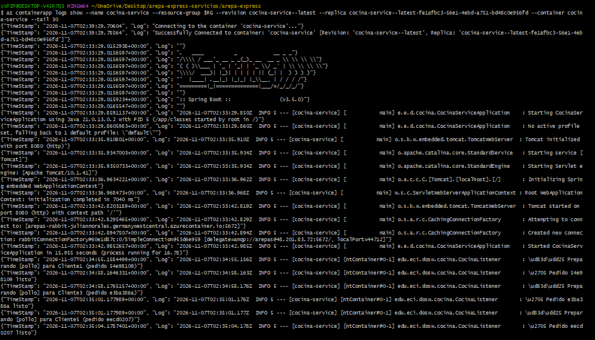

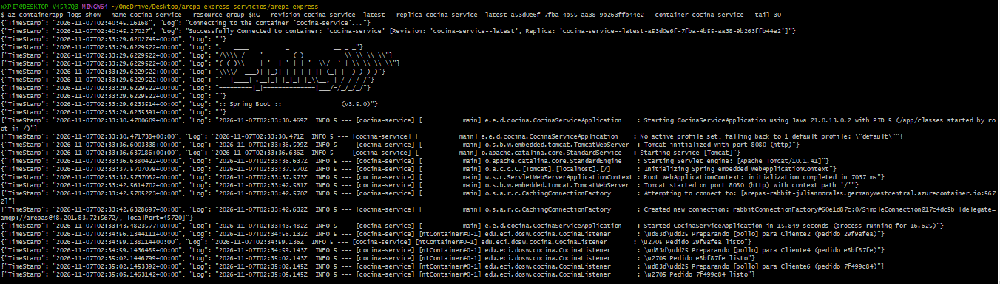

Los consumidores de una misma cola compiten por los mensajes, así que la tarea lenta se puede escalar horizontalmente.

### Experimento 3 · Los mensajes esperan

En el panel se creó la cola `auditoria.pedidos` y se unió al exchange con la routing key `pedido.#`:

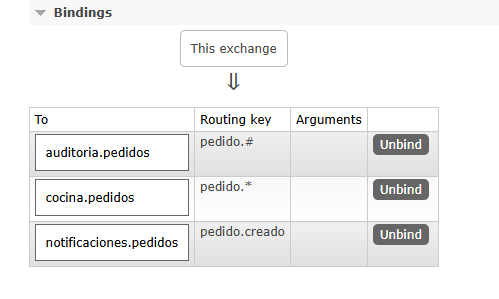

Se enviaron 3 pedidos. Como **nadie consume** esa cola, los 3 mensajes quedaron guardados (**Ready = 3**):

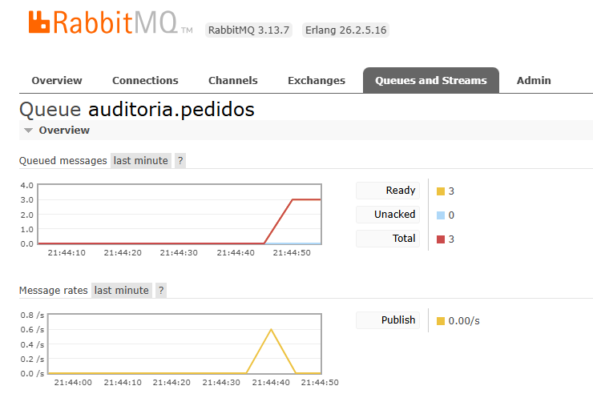

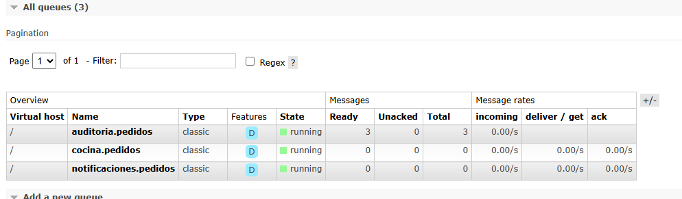

Eso es lo que permite que un servicio caído no pierda eventos: el broker los retiene hasta que el consumidor vuelva.

---

## 4. Preguntas para pensar

**¿Qué pasa con los pedidos si cocina-service se cae por 5 minutos?**
No se pierden. La cola `cocina.pedidos` es durable y está unida al exchange, así que RabbitMQ sigue guardando los mensajes aunque no haya consumidor. Mientras tanto `pedidos-service` sigue respondiendo a los clientes. Cuando cocina vuelve, consume lo acumulado (como mostró el experimento 3).

**¿Por qué el gateway devuelve 401 sin que el servicio se entere?**
Porque la validación de la llave de suscripción ocurre en el gateway, antes de reenviar la petición. Si falta o es inválida, el gateway corta la llamada y el microservicio nunca recibe tráfico.

**¿Dónde validarías el token de un usuario: en el gateway o en cada microservicio?**
La validación principal (firma, expiración, emisor) en el gateway, para rechazar temprano y no repetir lógica. Aun así, los servicios con datos sensibles deberían verificar la autorización fina y no confiar ciegamente, porque si alguien llega a un servicio sin pasar por el gateway no habría barrera: autenticación en el borde y autorización donde está la regla de negocio.

**¿Qué pasa si el pedido se crea pero el evento no se alcanza a publicar?**
Hay una inconsistencia: el cliente recibe `RECIBIDO` pero la cocina nunca se entera. Crear el pedido y publicar el evento son dos operaciones sin transacción común. Se mitiga con el patrón *Transactional Outbox* (guardar pedido y evento en la misma transacción y publicar los pendientes aparte), *publisher confirms* de RabbitMQ y reintentos.

**¿Cuándo usarías una cola y cuándo un tópico en Style Radar?**
Una cola de trabajo cuando una tarea la deba hacer un solo consumidor entre varios (por ejemplo procesar cada imagen o publicación subida, repartiendo la carga entre réplicas). Un tópico (exchange topic con una cola por servicio) cuando un mismo evento interesa a varios, por ejemplo "nueva prenda publicada": un servicio actualiza el catálogo, otro notifica a quienes siguen la marca y otro alimenta las recomendaciones.

---

## Cómo ejecutar en local

Requisitos: Java 21, Maven y Docker (solo para RabbitMQ).

```bash
docker run -d -p 5672:5672 -p 15672:15672 \
  -e RABBITMQ_DEFAULT_USER=arepas -e RABBITMQ_DEFAULT_PASS=arepas123 rabbitmq:3-management

# en una terminal por servicio
cd menu-service && mvn spring-boot:run
cd pedidos-service && mvn spring-boot:run          # puerto 8080 (cambiar si corren juntos)
cd cocina-service && mvn spring-boot:run
cd notificaciones-service && mvn spring-boot:run
```

Los tres servicios con RabbitMQ leen `RABBIT_HOST`, `RABBIT_USER` y `RABBIT_PASS` (por defecto `localhost`, `arepas`, `arepas123`). Si se ejecutan juntos en local, hay que darles puertos distintos (`--server.port=808X`).

## Despliegue en Azure (resumen)

1. Grupo de recursos y proveedores registrados (`Microsoft.App`, `OperationalInsights`, `ApiManagement`, `ContainerInstance` y `ContainerRegistry`).
2. RabbitMQ en Azure Container Instances (puertos 5672 y 15672) y API Management en plan Consumption.
3. Imágenes en un Azure Container Registry y Container Apps para los cuatro servicios (`cocina` y `notificaciones` con ingress interno y una réplica fija, porque no reciben tráfico HTTP).
4. APIs y política en el gateway.

Notas de la suscripción **Azure for Students** que afectaron el despliegue:

- **Región:** una política de la suscripción solo permite ciertas regiones (`spaincentral`, `northcentralus`, `belgiumcentral`, `mexicocentral`, `germanywestcentral`); se usó `germanywestcentral`. `eastus` no está permitida.
- **ACR Tasks bloqueado:** `az containerapp up --source` falló con `TasksOperationsNotAllowed`. Se construyeron las imágenes con **Jib** (plugin de Maven, sin Docker) y se subieron al registro; las Container Apps se crearon con `az containerapp create --image`:

  ```bash
  mvn -q package -DskipTests com.google.cloud.tools:jib-maven-plugin:3.4.5:build \
    -Dimage=$ACR.azurecr.io/<servicio>:v1 \
    -Djib.from.image=mcr.microsoft.com/openjdk/jdk:21-ubuntu \
    -Djib.to.auth.username=$ACR_USER -Djib.to.auth.password=$ACR_PASS
  ```

- **Git Bash en Windows** convierte argumentos que empiezan por `/` en rutas de Windows (`/menu` pasó a `/C:/Program Files/Git/menu`) y el gateway devolvía 404; se corrigió con `MSYS_NO_PATHCONV=1`.
- **Tildes en `curl` desde Git Bash:** `"Andrés"` produjo `400 Bad Request` por la codificación de la consola; se usó `"Andres"`.

> La clave de RabbitMQ y la llave de suscripción del gateway se pasaron por variables de entorno y **no** se guardan en el repositorio. En un proyecto real irían como *secrets* de Container Apps o en Key Vault.

## Limpieza

Para no gastar créditos, al terminar se eliminó el grupo de recursos completo:

```bash
az group delete --name $RG --yes --no-wait
```

## Estructura del repositorio

```
.
├─ menu-service/
├─ pedidos-service/
├─ cocina-service/
├─ notificaciones-service/
└─ docs/capturas/        # evidencias usadas en este README
```
